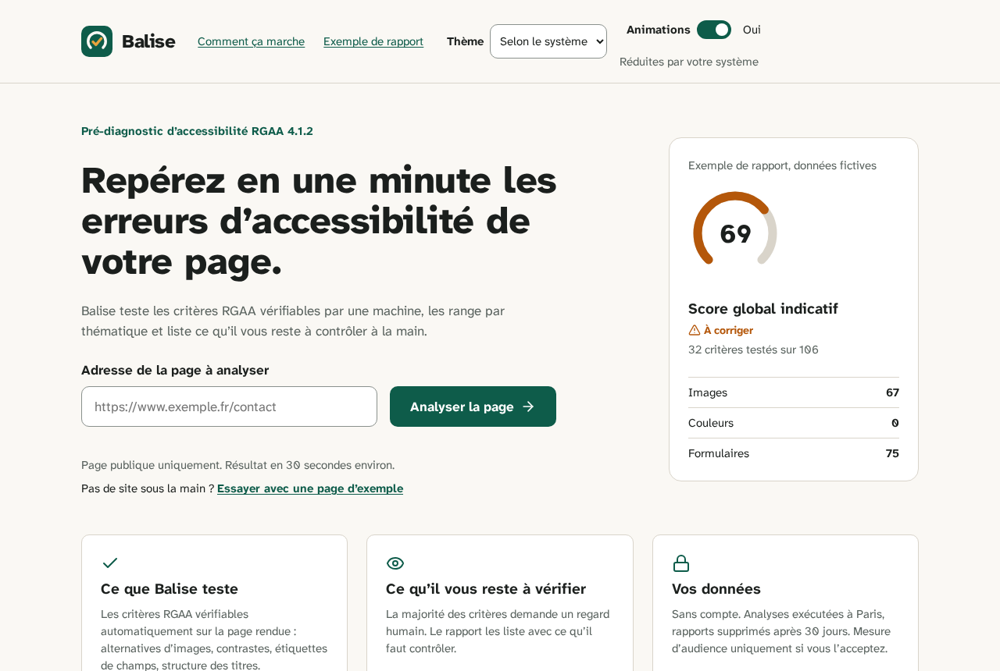
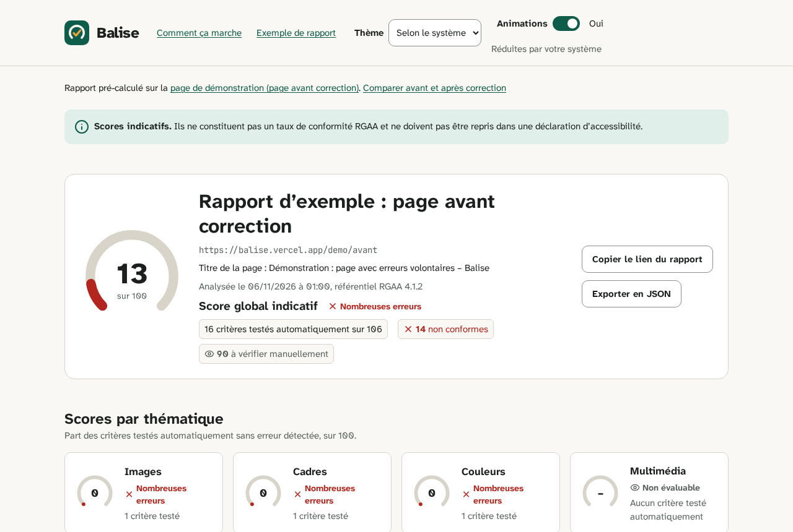

# Balise

[](https://github.com/Mvth1s/balise/actions/workflows/ci.yml)
[](https://github.com/Mvth1s/balise/actions/workflows/codeql.yml)
[](LICENSE)

Pré-diagnostic d'accessibilité RGAA à partir d'une URL : score indicatif par thématique, erreurs détectées et critères à vérifier manuellement.

- Application : https://balise-tau.vercel.app
- Documentation : [`docs/`](docs/)

> **Scores indicatifs.** Ils ne constituent pas un taux de conformité RGAA et ne doivent pas être repris dans une déclaration d'accessibilité.

## Présentation

Vous saisissez l'adresse d'une page web publique. Balise :

1. vérifie que l'adresse désigne bien une page publique ;
2. charge la page dans un navigateur Chromium headless, avec son JavaScript ;
3. exécute axe-core et une vingtaine de contrôles maison de détection d'erreurs (lien d'évitement, titres, langue, titre de page, type de document, identifiants, tableaux, images, liens génériques, étiquettes et regroupements de champs, focus visible, balises de présentation…) ;
4. range les résultats par critère et par thématique du RGAA 4.1.2 ;
5. affiche un score indicatif par thématique et un score global, toujours avec leur couverture (« 32 critères testés automatiquement sur 106 »).

Le rapport liste, pour chaque critère non conforme, le problème expliqué en français, les éléments concernés, une piste de correction et un lien vers le critère officiel. Une liste de critères à vérifier manuellement l'accompagne. Chaque rapport a une adresse unique, partageable pendant 30 jours. [À COMPLÉTER : confirmer l'export JSON du rapport une fois l'écran de rapport livré]

Une démonstration est disponible sans lancer d'analyse : une page fictive avec des erreurs volontaires (`/demo/avant`), la même page corrigée (`/demo/apres`) et leurs rapports pré-calculés.

## Captures





## Démarrage local

Prérequis : Node.js 24 (voir `.nvmrc`) et pnpm 12 (`corepack enable`).

```sh
pnpm install                              # installe tout le monorepo
pnpm exec playwright install chromium     # navigateur local pour l'analyse, les tests et la démo
pnpm dev                                  # front (Vite)
pnpm dev:api                              # API locale, dans un second terminal
```

Sans variables Upstash, l'API utilise un stockage en mémoire : aucun compte n'est nécessaire pour développer. Le modèle des variables est `.env.example` ; leur rôle est décrit dans [`docs/exploitation.md`](docs/exploitation.md).

Autres commandes :

```sh
pnpm build            # paquets puis front
pnpm lint             # ESLint
pnpm typecheck        # TypeScript et vue-tsc
pnpm test             # tests unitaires et d'intégration (Vitest)
pnpm test:coverage    # idem avec couverture
pnpm test:e2e         # tests de bout en bout Playwright, avec axe
pnpm demo:build       # régénère les rapports de démonstration versionnés
```

Pour contribuer, lisez [`CONTRIBUTING.md`](CONTRIBUTING.md).

## Architecture

Monorepo pnpm, hébergé entièrement sur Vercel :

| Dossier                  | Rôle                                                                                        |
| ------------------------ | ------------------------------------------------------------------------------------------- |
| `apps/web/`              | Front Vue 3 + Vite, pages statiques pré-rendues                                             |
| `api/`                   | Points d'entrée Vercel Functions (Node.js, région `cdg1`, Paris), minces                    |
| `server/`                | Logique de l'API : handlers, stockage, limitation de débit                                  |
| `packages/analyzer/`     | Moteur : filtre SSRF, Chromium headless, axe-core, contrôles maison, correspondance, scores |
| `packages/rgaa-mapping/` | Référentiel RGAA 4.1.2 versionné et correspondances règle → critères                        |
| `e2e/`                   | Tests Playwright de bout en bout                                                            |

`POST /api/analyses` valide l'URL et répond `202` avec un identifiant ; l'analyse continue dans la même fonction grâce à `waitUntil`. Le front interroge `GET /api/analyses/:id` jusqu'au rapport. Les rapports sont stockés dans Upstash Redis (région Europe) pendant 30 jours.

Pour aller plus loin :

- [Architecture et frontières de sécurité](docs/architecture.md)
- [API](docs/api.md)
- [Calcul des scores](docs/scoring.md)
- [Correspondance RGAA](docs/rgaa-mapping.md)
- [Sécurité](docs/securite.md)
- [Exploitation](docs/exploitation.md)
- [Décisions d'architecture (ADR)](docs/adr/README.md)

## Limites

Balise est un outil de **pré-diagnostic**. Il aide à repérer des erreurs ; il ne remplace pas un audit.

- **Scores indicatifs.** Ils ne constituent pas un taux de conformité RGAA et ne doivent pas être repris dans une déclaration d'accessibilité. Seul un audit selon la méthode officielle, sur un échantillon de pages, mesure la conformité.
- **Couverture automatique partielle.** Une grande partie des critères du RGAA demande un jugement humain (pertinence d'une alternative, d'un titre, ordre de lecture, usage au clavier…). Ces critères restent « À vérifier manuellement ». « Aucune erreur détectée automatiquement » ne signifie pas que la page est accessible.
- **Une page, un état.** L'analyse porte sur une seule page, telle qu'elle s'affiche au chargement : pas d'interaction (menus, fenêtres modales, formulaires soumis).
- **Pages publiques uniquement.** Les pages derrière une authentification, un pare-feu ou un réseau privé ne sont pas analysées.
- **Plafonds.** 60 secondes de chargement, 300 requêtes, 15 Mo au total, 5 Mo par ressource. Les pages plus lourdes échouent.
- **Erreurs possibles.** Les tests automatiques peuvent signaler une erreur à tort ou en manquer une. Chaque rapport indique les versions d'axe-core, de Chromium et du référentiel utilisées.
- **10 analyses par heure** et par adresse IP.

## Accessibilité de Balise

Balise vise 100 % des critères RGAA applicables sur ses propres pages. Chaque page et chaque état sont testés automatiquement avec axe (zéro violation tolérée en CI), au clavier, à 200 % de zoom, à 320 px de large et avec la réduction des animations. L'audit manuel reste à faire : la déclaration d'accessibilité (page `/accessibilite` du site) en rend compte.

## Sécurité

- Filtre SSRF strict : `http` et `https` uniquement, ports 80 et 443, adresses DNS toutes publiques, vérifiées à la soumission puis à chaque connexion (protection contre le DNS rebinding) et à chaque redirection.
- Toutes les requêtes du navigateur headless sont interceptées et revalidées ; un proxy mort bloque celles qui échapperaient à l'interception.
- Tout contenu issu des pages analysées est affiché échappé.
- Adresses IP hachées (HMAC) pour la limitation de débit, jamais stockées en clair.
- Aucun secret dans le dépôt ; en-têtes de sécurité (CSP, HSTS…) dans `vercel.json`.

Pour signaler une vulnérabilité, ne publiez rien : suivez [`SECURITY.md`](SECURITY.md) ou écrivez à [mag.d3v+balise@pm.me](mailto:mag.d3v+balise@pm.me).

## Vie privée

Polices auto-hébergées, aucun appel à un tiers avant consentement. La mesure d'audience Google Analytics 4 n'est chargée que si elle est configurée et que vous l'acceptez.

## Licence

Code sous [licence MIT](LICENSE), © 2026 Mvth1s.

Polices Atkinson Hyperlegible Next et JetBrains Mono sous SIL Open Font License 1.1. Icônes Lucide sous licence ISC.
