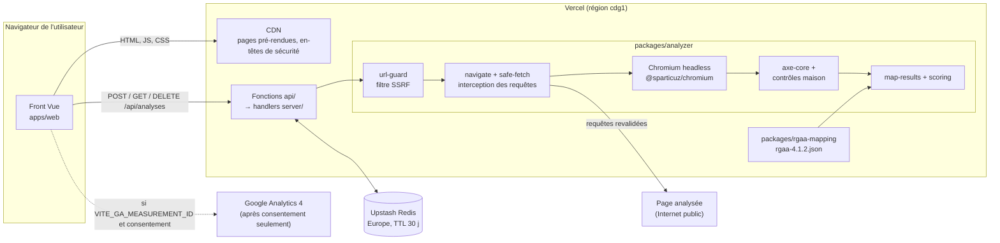
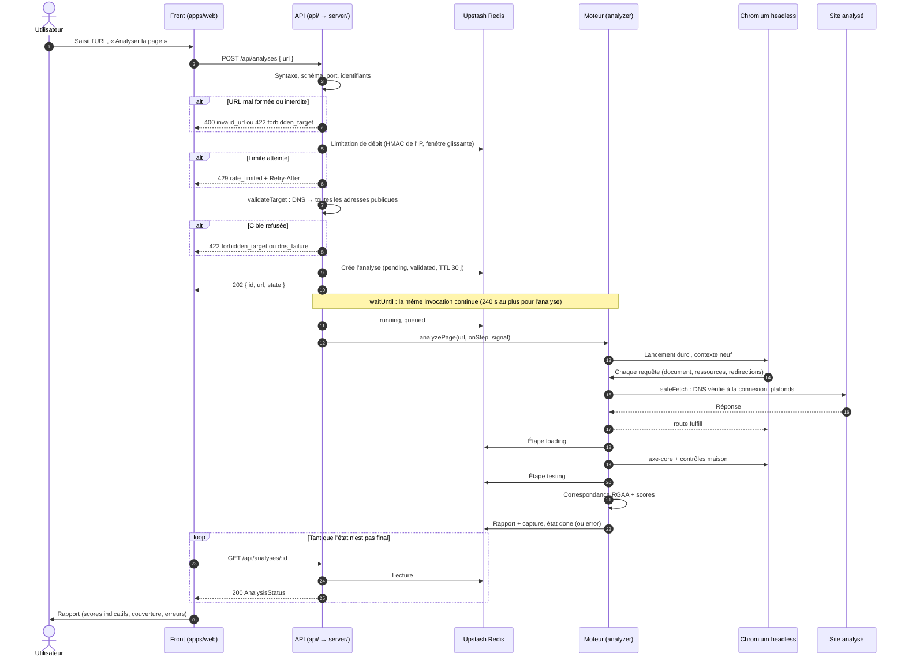
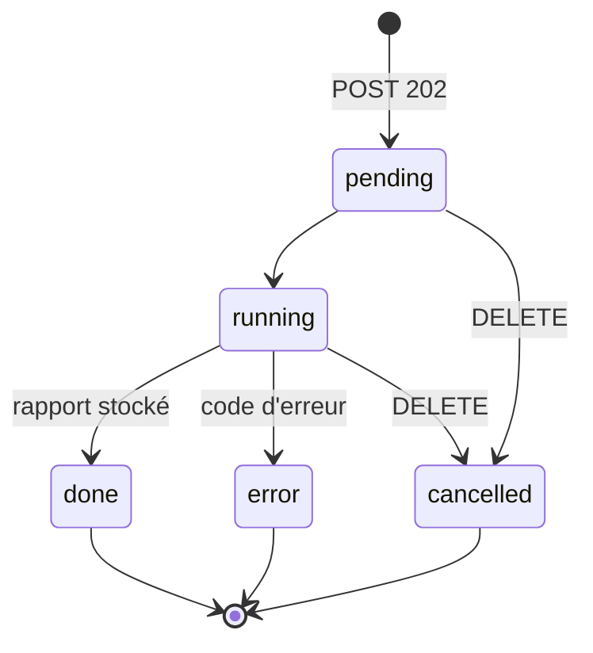
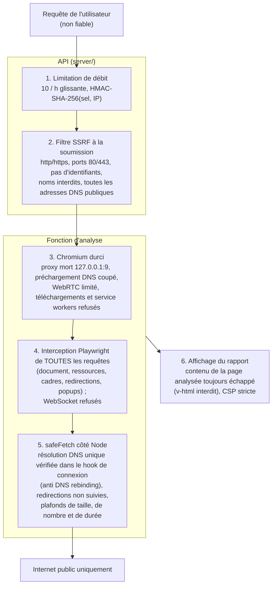

# Architecture

Ce document décrit comment Balise est construit : les composants, le parcours d'une analyse et les frontières de sécurité. Les choix sont justifiés dans les [ADR](adr/README.md). La sécurité est détaillée dans [`securite.md`](securite.md).

> **Scores indicatifs.** Balise ne mesure pas un taux de conformité RGAA. Voir [`scoring.md`](scoring.md).

## Vue d'ensemble

Balise est hébergé entièrement sur Vercel ([ADR 0001](adr/0001-hebergement-vercel.md)) :

- un **front** Vue 3 pré-rendu (accueil, pages légales, démo), servi par le CDN de Vercel ;
- une **API** en Vercel Functions (runtime Node.js, région `cdg1`, Paris) ;
- un **moteur d'analyse** qui pilote un Chromium headless dans la fonction elle-même ;
- un **stockage** Upstash Redis (région Europe) pour l'état des analyses, les rapports, les captures et la limitation de débit ([ADR 0002](adr/0002-stockage-upstash.md)).

Il n'y a ni serveur à administrer, ni worker séparé : l'analyse se poursuit après la réponse `202` grâce à `waitUntil` (`@vercel/functions`).

## Composants

| Composant           | Dossier                  | Rôle                                                                                                                                                             |
| ------------------- | ------------------------ | ---------------------------------------------------------------------------------------------------------------------------------------------------------------- |
| Front               | `apps/web/`              | Vue 3, Vite, vue-router, vite-ssg. Formulaire, écran d'analyse, rapport, démo, pages légales, bandeau de consentement. Client d'API dans `src/lib/api.ts`.       |
| Points d'entrée API | `api/`                   | Fichiers minces : un fichier = une fonction Vercel. Ils délèguent à `server/`.                                                                                   |
| Logique API         | `server/`                | Handlers `Request` → `Response`, validation, limitation de débit, stockage (`AnalysisStore`), lancement de l'analyse. Testable sans Vercel.                      |
| Moteur              | `packages/analyzer/`     | Filtre SSRF, client HTTP sûr, lancement de Chromium, navigation interceptée, axe-core, contrôles maison, correspondance RGAA, scores.                            |
| Référentiel RGAA    | `packages/rgaa-mapping/` | `rgaa-4.1.2.json` : 13 thématiques, 106 critères, correspondances règle → critères ([ADR 0005](adr/0005-mapping-rgaa.md), [`rgaa-mapping.md`](rgaa-mapping.md)). |
| Stockage            | Upstash Redis            | État, rapport et capture de chaque analyse (TTL 30 jours) ; compteurs de limitation de débit (IP hachée, fenêtre glissante d'une heure).                         |
| Outils              | `scripts/`               | `e2e-server.ts` (serveur local des tests e2e, relit `vercel.json`), `dev-api.ts` (API locale), `demo-build.ts` (rapports de démo).                               |

## Parcours d'une analyse

1. **Soumission.** Le front envoie `POST /api/analyses` avec `{ "url": "…" }`.
2. **Contrôles synchrones** (`server/handlers.ts`). L'API vérifie d'abord la syntaxe de l'URL (schéma `http`/`https`, ports 80 et 443, absence d'identifiants) : une requête refusée ici ne consomme pas de quota. Puis la limitation de débit : 10 analyses par heure en fenêtre glissante, clé `HMAC-SHA-256(RATE_LIMIT_SALT, ip)`. Enfin la cible : noms d'hôte interdits et **toutes** les adresses DNS résolues, qui doivent être publiques (`validateTarget`, `packages/analyzer/src/url-guard.ts`).
3. **Création.** L'API enregistre l'analyse (état `pending`, étape `validated`) avec un TTL de 30 jours et répond `202 { id, url, state }`.
4. **Suite en arrière-plan.** Dans la même invocation, `waitUntil` poursuit le travail après la réponse : l'état passe à `running` (étape `queued`), puis `analyzePage()` s'exécute (`packages/analyzer/src/analyze.ts`). Un minuteur borne l'analyse entière à 240 s, sous la limite de 300 s de la fonction ; au-delà, l'analyse passe en erreur `unreachable`.
5. **Chargement.** Chromium est lancé avec des options de durcissement ; un contexte neuf est créé (téléchargements refusés, service workers bloqués, permissions vides). Toutes les requêtes de la page sont interceptées et exécutées par `safeFetch` (voir plus bas). Attente de l'événement `load`, puis d'un calme réseau (500 ms sans requête, 10 s au plus), dans un budget total de 60 s. Capture JPEG de la zone visible (1280 × 800, qualité 60). Étape `loading`.
6. **Tests.** Une fois le chargement terminé, l'interception refuse toute nouvelle requête : la page est figée. axe-core s'exécute (étiquettes WCAG 2 A/AA, 2.1 A/AA, 2.2 AA, plus toutes les règles reliées au référentiel), puis les contrôles maison (`balise-skip-link`, `balise-heading-hierarchy`, `balise-page-lang`, `balise-page-title`). Étape `testing`.
7. **Correspondance et scores.** Chaque résultat de règle est rattaché aux critères RGAA via `rgaa-4.1.2.json` ; chaque critère reçoit un statut (`conforme`, `non-conforme`, `a-verifier`, `non-applicable`). Les scores de thématique et le score global sont calculés (`scoring.ts`, pondération dans `packages/analyzer/src/config/scoring.json`). Étape `scoring`.
8. **Stockage.** Le rapport (`AnalysisReport`) et la capture sont écrits dans Redis ; l'état passe à `done`. En cas d'échec, l'état passe à `error` avec un code et un message en français ; en cas d'annulation, à `cancelled`.
9. **Suivi.** Le front interroge `GET /api/analyses/:id` jusqu'à un état final (`done`, `error`, `cancelled`), affiche les étapes, puis le rapport. L'adresse `/analyses/:id` est partageable pendant 30 jours.

États et étapes (définis dans `packages/analyzer/src/types.ts`) :

- États : `pending`, `running`, `done`, `error`, `cancelled`.
- Étapes affichées, dans l'ordre : `validated` (adresse vérifiée), `queued` (prise en charge), `loading` (chargement de la page), `testing` (tests RGAA), `scoring` (calcul des scores). Le champ `step` indique la dernière étape **terminée**. L'API écrit `validated` à la création et `queued` au démarrage ; le moteur signale `loading`, `testing` et `scoring`.
- Annulation : `DELETE /api/analyses/:id` écrit l'état `cancelled` dans Redis (seulement si l'analyse est `pending` ou `running`) et répond `202` avec l'état. Le `DELETE` peut arriver sur une autre instance que celle qui exécute l'analyse ; l'exécution l'apprend donc par le stockage, de deux façons :
  - avant **chaque écriture** (étape, rapport, erreur), l'état est relu ; s'il vaut `cancelled` (ou a disparu), l'écriture est abandonnée et l'analyse s'arrête ;
  - le stockage est aussi **interrogé toutes les 2 s** ; un état `cancelled` déclenche l'`AbortSignal` du moteur, qui ferme la page pendant le chargement ou s'arrête entre deux étapes.
- Limite connue : la relecture puis l'écriture ne sont pas atomiques. Un `DELETE` qui arrive exactement entre les deux peut être écrasé (commentaire `shortcut` dans `server/handlers.ts`).

## Frontières de sécurité

Le détail (modèle de menace, cas limites testés) est dans [`securite.md`](securite.md). Résumé des barrières, de l'extérieur vers l'intérieur :

1. **Limitation de débit** (`server/rate-limit.ts`). 10 analyses par heure, en fenêtre glissante. La clé est `HMAC-SHA-256(RATE_LIMIT_SALT, ip)`, l'IP venant de `x-real-ip` (posé par Vercel), sinon du premier élément de `x-forwarded-for` ; elle n'est jamais stockée en clair. Les clés expirent avec la fenêtre, bien avant 24 heures. Au-delà de la limite : `429` avec `Retry-After`.
2. **Filtre SSRF à la soumission** (`url-guard.ts`). Seuls `http` et `https`, ports 80 et 443, sans identifiant ni mot de passe, URL de 2 048 caractères au plus. Noms refusés : `localhost`, `metadata.google.internal`, suffixes `.localhost`, `.internal`, `.local`, `.home.arpa`, `.localdomain`. Toutes les adresses A et AAAA doivent être publiques : plages privées, réservées, de bouclage, link-local (dont `169.254.169.254`, métadonnées cloud), CGNAT, documentation, multicast refusées ; en IPv6, seul `2000::/3` est accepté, et les formes qui embarquent une IPv4 (mappée, NAT64, compatible) sont jugées sur l'IPv4.
3. **Chromium durci** (`browser.ts`). Un proxy mort (`--proxy-server=http://127.0.0.1:9`, sans exception pour le bouclage) fait échouer toute requête qui échapperait à l'interception. Préchargement DNS, réseau en arrière-plan, WebRTC non proxifié et DNS sur HTTPS sont désactivés.
4. **Interception Playwright** (`navigate.ts`). Chaque requête du contexte est revalidée puis exécutée par `safeFetch` ; la réponse est rendue au navigateur par `route.fulfill`. Une redirection est rendue telle quelle : le navigateur émet une nouvelle requête, interceptée et revalidée à son tour. Après le chargement, toute nouvelle requête est refusée.
5. **Client HTTP sûr** (`safe-fetch.ts`). Le nom d'hôte est résolu **une seule fois**, dans le hook `lookup` du socket ; les adresses y sont vérifiées et le socket se connecte à ces mêmes adresses. Plafonds par défaut : 60 s de chargement, 20 s par requête, 300 requêtes, 15 Mo au total, 5 Mo par ressource (après décompression).
6. **Affichage.** Tout texte issu de la page analysée (sélecteurs, extraits HTML, titre) est stocké brut et affiché comme du texte. `v-html` est interdit par une règle ESLint. La CSP (`vercel.json`) n'autorise que `'self'` et les domaines de Google Analytics.

Le paramètre `allowPrivateHosts`, qui désactive les contrôles d'adresse, n'existe qu'au niveau du code, pour les tests et `pnpm demo:build`. Il n'est jamais lu depuis l'environnement.

## Données et durées de conservation

| Donnée                                                                        | Où                                                                                                   | Durée                                                        |
| ----------------------------------------------------------------------------- | ---------------------------------------------------------------------------------------------------- | ------------------------------------------------------------ |
| État, rapport, capture d'une analyse                                          | Upstash Redis                                                                                        | 30 jours (TTL)                                               |
| Compteur de limitation de débit                                               | Upstash Redis                                                                                        | Fenêtre glissante d'une heure (bien moins de 24 heures)      |
| Préférences (thème, animations, choix de consentement, liste de vérification) | Stockage local du navigateur (`balise:theme`, `balise:motion`, `balise:consent`, `balise:checklist`) | Choix de consentement : 6 mois ; autres : jusqu'à effacement |

Clés Redis (`server/store.ts`, `server/rate-limit.ts`) :

| Clé                               | Contenu                                                                                   | Expiration                               |
| --------------------------------- | ----------------------------------------------------------------------------------------- | ---------------------------------------- |
| `balise:analysis:<id>`            | `AnalysisStatus` en JSON (état, étape, erreur, rapport)                                   | 30 jours, remis à zéro à chaque écriture |
| `balise:analysis:<id>:screenshot` | `{ "jpeg": "<base64>" }`                                                                  | 30 jours                                 |
| `balise:ratelimit:…`              | Compteurs de `@upstash/ratelimit`, sous le préfixe `balise:ratelimit`, par empreinte HMAC | Gérée par la fenêtre glissante           |

Sans `KV_REST_API_URL` et `KV_REST_API_TOKEN` (ou `UPSTASH_REDIS_REST_URL` et `UPSTASH_REDIS_REST_TOKEN`), l'API utilise un stockage et un limiteur en mémoire, réservés au développement local. Sur Vercel, l'absence de ces variables ou de `RATE_LIMIT_SALT` fait répondre `500 internal` à toutes les requêtes, plutôt que de fonctionner sans stockage partagé.

## Mode de test de bout en bout

`BALISE_E2E_FAKE_ANALYZER=1` remplace le moteur par `server/fake-analyzer.ts` (aucun navigateur, aucun réseau, DNS factice). Ce mode est refusé si `NODE_ENV=production` ou sur Vercel. Dans ce mode seulement, l'en-tête `x-balise-e2e-client` complète la clé de limitation de débit pour isoler les tests. Voir [`api.md`](api.md#mode-de-test-de-bout-en-bout).

## Évolutions prévues

- **Migration vers un VPS OVHcloud** si les limites serverless deviennent bloquantes : worker conteneurisé et file Redis, API inchangée ([ADR 0001](adr/0001-hebergement-vercel.md), [`exploitation.md`](exploitation.md)).
- **RGAA 5** : nouveau fichier de référentiel au même format, sans changer le moteur ([`rgaa-mapping.md`](rgaa-mapping.md)).
